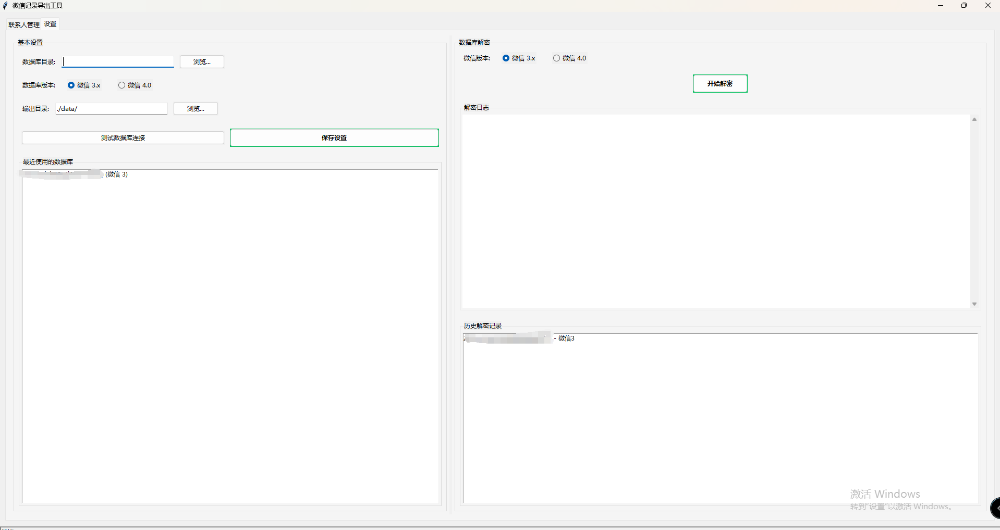
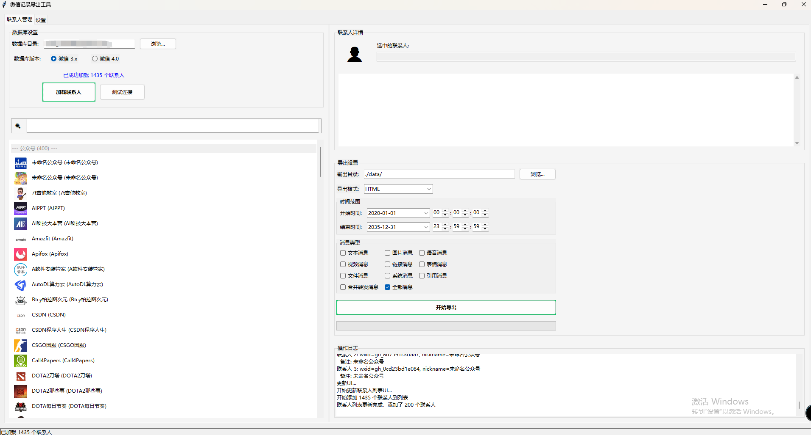

# WeChatMsg GUI

这是一个基于原始留痕(MemoTrace)项目（https://github.com/LC044/WeChatMsg）二次开发的微信记录导出工具，提供了全新的图形用户界面(GUI)，使微信聊天记录的导出操作变得更加简单直观。

本仓库在 [Mountain-AI/WeChatMsg](https://github.com/Mountain-AI/WeChatMsg) 的基础上继续维护，主要补充了对**微信 4.1 版本**的适配（原项目最后更新停留在 2025 年，仅支持到微信 4.0）。

## 本仓库相对上游的改动

上游项目已停止更新，微信 4.1 起数据库的密钥存储与表结构都发生了变化，直接使用会报「未找到 key」。本仓库修复了以下问题：

| 问题 | 现象 | 处理方式 |
|---|---|---|
| 4.1 密钥提取失败 | 解密时报「未找到 key」，重启微信无效 | 微信 4.1.10+ 内存中不再是明文口令，而是 XOR 混淆后的值。新增从 `Weixin.dll` 代码段静态提取内部 XOR key，还原后再做 PBKDF2/HMAC 校验 |
| 密钥候选遗漏 | 上一项修复后仍可能取不到 key | 修正只取每处匹配第一个实例的逻辑，改为遍历全部实例（候选量提升数十倍） |
| hardlink 表名变更 | 导出含图片的消息时报 `no such table: image_hardlink_info_v3` | 4.1 将表名改为 `*_v4`，改为运行时查询 `sqlite_master` 自动识别 v3/v4 |
| 目录检查误判 | 4.x 的数据库在子目录里，程序误报「目录中没有数据库文件」 | 改为递归查找 |
| 配置字段格式 | 启动或加载联系人时抛 `string indices must be integers` | 补齐配置结构兼容与缺失方法 |
| 4.2 图片全部导出为空 | HTML 导出成功但 `image/` 目录是空的，控制台无报错 | 4.2 的图片改用**账号级密钥**，上游内置的是 4.0.3 的固定密钥，解出来不是有效图片。新增 `wxManager/decrypt/key_derive.py` 在运行时推导密钥（见下节） |

适配策略是「广撒网 + 库头校验」：无论候选 key 从哪条路径得到，只有能通过 HMAC 校验的才会被采用，因此 4.0 与 4.1 走同一套代码，不依赖版本号判断。

## 微信 4.2 图片解密修复

### 问题

微信 4.0/4.1 的聊天图片缓存文件（`<md5>.dat`）用的是**固定图片密钥**，上游把这些密钥硬编码在 `wxManager/decrypt/decrypt_dat.py` 的 `AES_KEY_MAP` 里，所以能直接解。

微信 4.2 换了机制：图片密钥变成**账号级**的，每个账号不同。结果就是：

- 数据库能解密、消息能导出、HTML 也能生成
- 但导出目录里的 `image/` 始终是空的，或者解出来是 `.bin` 无效文件
- **控制台不报错**，日志里也看不出来，很容易误判成"这个群本来就没图"

### 解密结构

`<md5>.dat` 是两段式加密：

```
[15B 头] [aes_size u32 LE] [xor_size u32 LE] [1B flag]
[AES-128-ECB 段: aes_size + 16 字节] [XOR 段: xor_size 字节]
```

两把密钥都由同一个**账号级 code** 派生：

```
xor_key = code & 0xFF
aes_key = MD5(f"{code}{wxid}")[:16]      # 16 字节 ASCII
```

`code` 由微信写入 kvcomm 目录下的统计文件名里：

```
%APPDATA%\Tencent\xwechat\<模块>\kvcomm\key_<code>_<uid>_..._input.statistic
```

### 本仓库的处理

**不硬编码任何密钥**（硬编码别人的账号密钥既无意义也泄露隐私）。新增 `wxManager/decrypt/key_derive.py`，运行时按下面流程自动定位：

1. 从 `.dat` 路径里解析 wxid（`...\wxid_xxx_a2e3\msg\attach\...`）
2. 扫描本机所有 `kvcomm` 目录，从文件名收集候选 code
3. 用每个候选 code 试解该 dat 的 AES 段
4. 校验解密结果是否为合法图片魔数（JPEG/PNG/GIF/BMP/WEBP），命中即采用并缓存

这样**换账号、换机器、微信升级后 code 变化都能自动适配**，仓库里不留任何人的密钥。验证方式：

```python
from wxManager.decrypt import key_derive
print(key_derive.resolve_keys(r'D:\Tencent\xwechat_files\wxid_xxx\msg\attach\...\Img\xxx.dat'))
# (b'<aes_key>', <xor_key>, <code>)，失败返回 (None, None, None)
```

### 已知限制

- `wxgf` 格式（微信私有动图容器，文件头 `wxgf`）无法解，会输出 `.bin`，约占图片总数的 1%
- 个别超过 1 MB 的图因缓存写入不完整会解出损坏文件，需重新在微信里打开一次该图触发缓存
- AES 密钥推导依赖 `%APPDATA%` 下的 kvcomm 目录，**必须在同一台机器、同一 Windows 用户下运行**

## 预览


*设置与数据库解密*


*联系人管理与聊天记录导出*


## 项目特点

- **多功能导出**：支持多种导出格式（HTML、TXT、DOCX、MARKDOWN、XLSX等）
- **联系人管理**：可视化的联系人列表，支持搜索和筛选
- **数据库解密**：内置微信 3.x、4.0、4.1 版本数据库解密功能
- **批量操作**：支持批量导出多个联系人的聊天记录
- **自定义选项**：可选择导出的消息类型和时间范围

## 系统要求

- Windows操作系统（Windows 10或更高版本）
- Python 3.8 ~ 3.12（**推荐 3.11**）。3.13+ 部分锁定依赖（pywin32==308、pymem、yara-python）暂无对应轮子，会装不上
- 已安装并登录的微信客户端

## 安装步骤

### 方法一（暂未打包）：直接下载可执行文件

<!-- 1. 从项目发布页下载最新的可执行文件 -->
<!-- 2. 解压后双击运行`WeChatExporter.exe` -->

### 方法二：从源码安装

1. 克隆项目代码：
   ```
   git clone https://github.com/2947846167/WeChatMsg.git
   cd WeChatMsg
   ```

2. 安装依赖：
   ```
   pip install -r requirements.txt
   ```
   
   或使用批处理文件：
   ```
   install.bat
   ```

3. 运行程序：
   ```
   python run_wechat_export.py
   ```

## 使用方法

### 1. 数据库解密

1. 在"设置"选项卡中，选择微信版本（3.x，或 4.0 / 4.1）
2. 指定微信数据库目录（如不确定，可点击"测试连接"自动查找）
3. 点击"解密微信数据库"按钮

### 2. 联系人管理

1. 解密成功后，切换到主界面
2. 点击"加载联系人"按钮
3. 使用搜索框查找特定联系人
4. 点击联系人查看详细信息

### 3. 导出聊天记录

1. 选择需要导出记录的联系人
2. 设置输出目录和导出格式
3. 可选择消息类型和时间范围
4. 点击"开始导出"按钮
5. 等待导出完成，查看结果

## 常见问题

### 解密失败
- 确保微信已登录并正常运行
- 关闭微信后重新尝试
- 检查是否选择了正确的微信版本

### 联系人加载失败
- 确保数据库解密成功
- 检查数据库文件是否存在
- 尝试重新解密数据库

### 导出过程中出错
- 检查输出目录是否有写入权限
- 确保微信客户端没有锁定相关文件
- 查看日志区域的错误信息


## 技术支持

如遇问题，请通过以下方式获取帮助：
- 查看日志区域的错误信息
- 在项目Issues页面提交问题
- 参考原始MemoTrace项目的文档

## 作者与贡献者

### 主要贡献者
- [Xyy-tj] - GUI界面重构与功能

### 原始项目贡献者
- [LC044](https://github.com/LC044) - 原始MemoTrace (WeChatMsg)项目作者
- 原项目所有贡献者的努力与支持

## 如何贡献

欢迎为本项目做出贡献！您可以通过以下方式参与：

1. Fork本仓库
2. 创建您的特性分支 (`git checkout -b feature/amazing-feature`)
3. 提交您的更改 (`git commit -m 'Add some amazing feature'`)
4. 推送到分支 (`git push origin feature/amazing-feature`)
5. 开启一个Pull Request

## 免责声明

本工具仅用于个人数据备份，请勿用于非法用途。使用本工具导出的聊天记录应当遵守相关法律法规，不得侵犯他人隐私。

## 许可证

本项目遵循与原始MemoTrace项目相同的许可证。详情请参见[LICENSE](LICENSE)文件。

## 致谢

特别感谢[原始MemoTrace项目](https://github.com/LC044/WeChatMsg)的开发者提供的基础代码和功能支持。本项目在其基础上开发了更直观的用户界面和额外功能。
